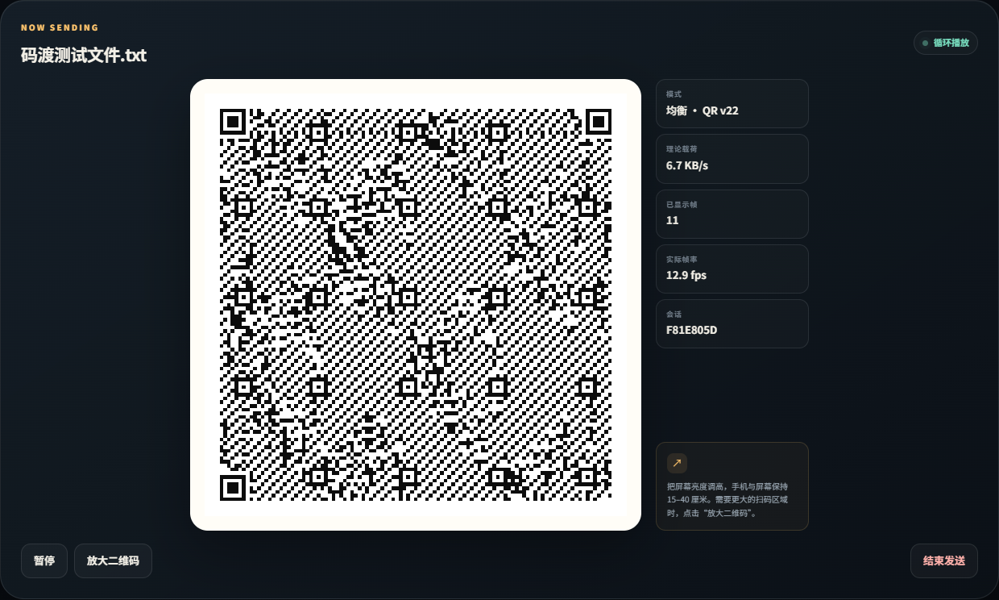
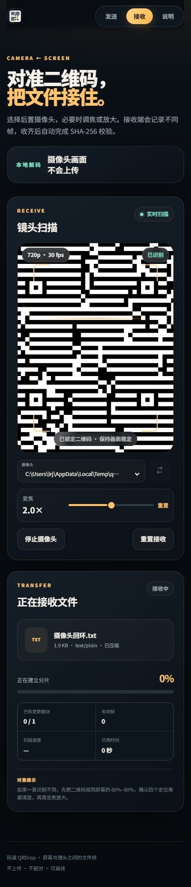
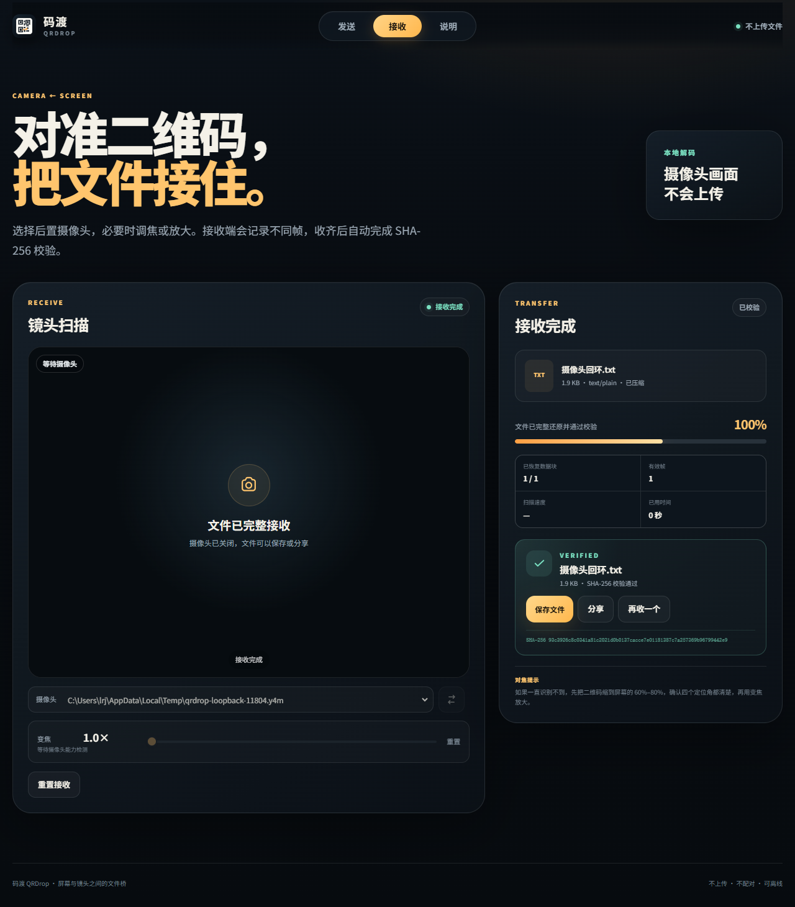

# 码渡 QRDrop

**用动态二维码在两台设备之间离线传文件。不上传、不配对，一台设备显示，另一台用镜头接收。**

在线使用：<https://renjunl-xdu.github.io/qrdrop/>

<p align="center">
  
</p>

<p align="center">
  
  
</p>

码渡把文件切成数据块，再用喷泉码生成连续变化的二维码。接收端不需要从第一帧开始，也不要求按顺序；漏扫、重复和轻微移动只会让传输多花一点时间。收齐数据后，浏览器会在本地还原文件并执行 SHA-256 完整性校验。

## 功能

- 电脑、Android 和 iPhone 都通过同一套浏览器界面运行
- 发送端循环播放动态二维码，接收端用摄像头连续扫描
- 喷泉码自动恢复漏扫帧，不需要回传确认
- 可选 gzip 压缩，文本、配置和日志通常能明显变小
- 可选密码保护，文件使用 PBKDF2 + AES-256-GCM 加密后再编码
- 接收完成显示 SHA-256 校验结果，可保存或调用系统分享
- PWA，可安装到手机桌面，首次加载后可离线使用
- 相机设备下拉选择与前后摄像头快速切换
- 检测浏览器公开的硬件变焦能力；不支持时自动回退为中心裁切数字变焦
- 支持连续对焦、可用时的补光灯、分辨率与帧率提示
- 稳定的响应式布局，手机竖屏和桌面大屏都可直接用

## 直接运行

需要 Node.js 20 或更新版本。项目运行时没有 npm 依赖。

```bash
npm start
```

浏览器打开 <http://localhost:8000>。`localhost` 是安全上下文，所以本机可以直接测试摄像头。

测试：

```bash
npm test
```

测试覆盖帧协议与 CRC、二维码二进制编码/解码、喷泉码丢帧恢复、压缩、加密以及完整文件回环。

## 两台设备怎么用

1. 发送端打开“发送”，选择文件，设置二维码密度。第一次建议使用“稳定”。
2. 点击“生成二维码”。发送端会循环播放动态二维码，屏幕亮度越高越好。
3. 接收端打开“接收”，点击“开启摄像头”，允许浏览器访问摄像头。
4. 在摄像头下拉框里选择后置或外接镜头。识别困难时调整变焦，让二维码完整落在取景框内。
5. 接收进度到 100% 后，文件会通过 SHA-256 校验。点击“保存文件”，或在手机上使用系统分享。

电脑发送、手机接收通常是成功率最高的组合。手机发送时，“稳定”模式比高密度模式更容易扫。

## 摄像头与变焦

浏览器对摄像头的控制能力取决于系统、浏览器和镜头驱动。

- 启动时优先请求后置摄像头，并列出 `videoinput` 设备。
- 如果 `track.getCapabilities().zoom` 存在，变焦滑杆直接调用硬件变焦。
- 如果镜头没有公开变焦能力，滑杆切换为数字变焦：扫描画面从中心裁切并放大。数字变焦不会创造更多像素，但能让二维码在解码器中占更大比例。
- 如果支持 `focusMode: continuous`，会尝试启用连续自动对焦。
- 如果支持 `torch`，界面会出现补光灯按钮。
- 权限授予前，浏览器通常隐藏摄像头名称；授予后会自动刷新设备列表。

摄像头必须运行在 HTTPS 页面或 `localhost` 上。直接用手机访问电脑的普通局域网 HTTP 地址时，大多数浏览器会拒绝摄像头权限。要让手机使用，请部署到 GitHub Pages、Cloudflare Pages、Netlify、Vercel 或任何 HTTPS 静态站点。

## GitHub Pages 部署

仓库包含 `.github/workflows/pages.yml`。把项目推到 `main` 后：

1. 打开仓库的 **Settings → Pages**。
2. 在 **Build and deployment** 中选择 **GitHub Actions**。
3. 工作流会先运行 `npm test`，通过后发布静态文件。

项目是纯静态站点，不需要构建命令，发布目录就是项目根目录。

## 协议设计

```text
文件
 ├─ 可选 gzip
 ├─ 可选 AES-256-GCM 加密
 ├─ 512 / 704 / 1024 字节源块
 ├─ 系统化 LT 喷泉码
 ├─ 自定义 18 字节二进制帧头
 ├─ 循环显示的 QR v18 / v22 / v27（纠错等级 M）
 └─ 屏幕 → 摄像头 → jsQR → CRC → 喷泉解码 → 解密/解压 → SHA-256
```

每个二维码帧包含：

- 4 字节魔数 `QRF2`
- 帧类型、会话 ID、分片号和编码序号（ESI）
- 帧级 CRC32
- 二进制载荷

文件元数据帧每 16 帧重复一次。喷泉码是系统化的，干净链路上前 K 个包就是原始数据；丢帧时才需要额外组合包补齐。

## 速度与边界

视觉链路是单向的，实际速度主要受二维码密度、帧率、镜头对焦、屏幕亮度和解码性能影响。稳定模式的理论有效载荷约 3.7 KB/s，均衡模式约 6.7 KB/s，高速模式约 13 KB/s；实际速度通常更低。

单文件上限为 32 MB。几 KB 到几百 KB 的文件体验最好，数 MB 通常需要几分钟。二维码不是大容量存储介质，传输超大文件请使用 U 盘、局域网或成熟的网络传输工具。

## 隐私说明

文件内容不上传到服务器。发送、编码、扫描、解码、校验和保存都在浏览器本地完成。

二维码是可见信道。任何拍摄到完整二维码流的人原则上都可能重建文件。启用密码保护后，二维码中只有密文；密码不会写入二维码，需要另外告诉接收方。不要在公共屏幕上传送未加密的私钥、密码或身份材料。

## 技术结构

- `src/protocol.js`：帧格式、CRC32、元数据校验
- `src/fountain.js`：系统化 LT 喷泉码与 peeling 解码
- `src/transfer.js`：文件准备、压缩、加密、发送会话和接收会话
- `src/qr.js`：浏览器二维码画布渲染
- `src/camera.js`：摄像头启动、设备枚举、对焦、变焦和补光灯
- `src/app.js`：界面状态、扫描循环和保存/分享流程
- `vendor/`：本地化的二维码编码和解码依赖

## 开源与致谢

本项目以 MIT 许可证发布。二维码生成使用
[qrcode-generator](https://github.com/kazuhikoarase/qrcode-generator)，
二维码解码使用 [jsQR](https://github.com/cozmo/jsQR)，喷泉码实现来自
[SoundBridge](https://github.com/RenjunL-xdu/soundbridge)。完整第三方声明见
[`NOTICE.md`](NOTICE.md)。

仓库：<https://github.com/RenjunL-xdu/qrdrop>
